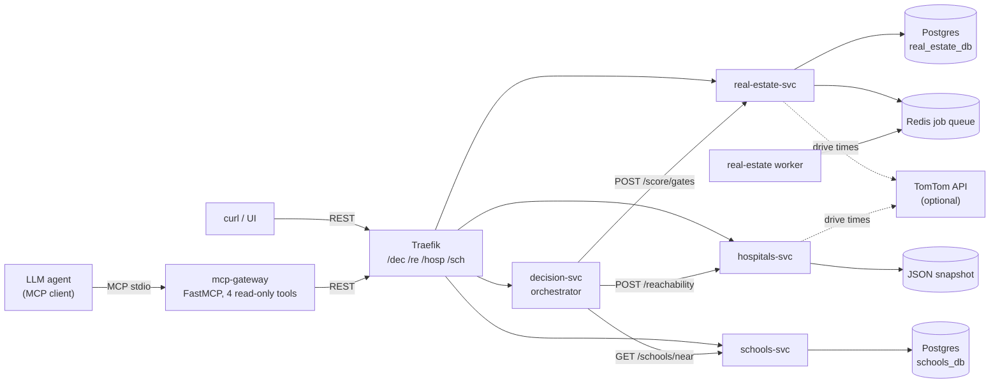

# Home Intelligence Platform

A set of small FastAPI services, plus an MCP server, that answer one question about a
home in Bangalore: does this location pass the checks that matter before you buy?

The checks are commute to a job hub at peak traffic, drive time to a hospital that can
handle a cardiac emergency, the number of schools nearby, and market risk signals
(builder distress flags, water supply stage, infrastructure stage of a growth corridor).
Each check is a hard gate. A location that fails any one gate is rejected, instead of a
good score on one axis averaging away a bad score on another.

The city data in `services/*/data/` is a small snapshot built from public sources. It is
there so the stack runs and the tests pass from a clean clone. See
[Data](#data) for what is in it and what is not.

## Quickstart

Requirements: Python 3.12+, [uv](https://docs.astral.sh/uv/), Docker (for the full stack).

```bash
make install        # uv sync --all-packages
make check          # ruff + mypy --strict + pytest
make compose-up     # Traefik + 4 services + Redis + 2 Postgres + one-shot loaders
```

With the stack up, everything goes through the gateway on port 8080:

```bash
curl -s localhost:8080/dec/areas | head
curl -s -X POST localhost:8080/dec/decision \
  -H 'content-type: application/json' \
  -d '{"address": {"query": "Koramangala"}, "budget_cr": 1.5}'
curl -s localhost:8080/re/corridors
curl -s localhost:8080/hosp/hospitals/quality
curl -s -X POST localhost:8080/sch/schools/shortlist \
  -H 'content-type: application/json' -d '{"area": "HSR"}'
```

To use it from an MCP client (a desktop assistant or an agent framework), point the client at
this command, which talks to the running stack:

```bash
PLATFORM_URL=http://localhost:8080 uv run --package mcp-gateway python -m mcp_gateway.server
```

No API key is needed. Without `TOMTOM_API_KEY` the services still answer, but drive
times come back as `null` and the commute and hospital gates fail closed, so every
verdict is `reject`. Set the key (see `.env.example`) to get traffic-aware drive times.

## Architecture



A decision request flows like this:

1. `decision-svc` resolves the address (explicit coordinates, or TomTom search with a
   Nominatim fallback).
2. It calls the three domain services concurrently with `asyncio.gather`.
3. `real-estate-svc` returns peak-traffic commute minutes to the job hub.
   `hospitals-svc` picks the three nearest quality hospitals by straight-line distance,
   then asks TomTom for real drive times to those three only, which caps paid routing
   calls at three per request. `schools-svc` returns schools within a radius.
4. `decision-svc` applies the gates and returns `buy` or `reject` with the list of
   failed gates and a short rationale.

### Layout

| Path | What it is |
|---|---|
| `services/decision` | Orchestrator. Owns no data; composes the other three over HTTP. |
| `services/real-estate` | RERA project search, commute gate, growth-corridor heuristic, async jobs, valuation and plot-plus-build cost models. |
| `services/hospitals` | Hospital quality table, capability scoring (cardiac vs general emergency), golden-hour reachability. |
| `services/schools` | School catalogue, radius search, area shortlist, fuzzy name search (`pg_trgm` in Postgres). |
| `mcp-gateway` | MCP server: `score_address`, `growth_corridors`, `hospital_quality`, `school_shortlist`. |
| `libs/platform_common` | Haversine, geocoders, TomTom router, retrying HTTP client with a circuit breaker, settings, JSON logging. |
| `libs/service_kit` | FastAPI app factory: `/health`, `/ready`, Prometheus `/metrics`, error-to-HTTP mapping. |
| `libs/contracts` | Pydantic v2 request and response models shared by every service. |
| `libs/jobs` | Job queue (in-memory and Redis adapters), worker loop, `POST /jobs/{task}` then poll `GET /jobs/{id}`. |
| `libs/persistence` | Async SQLAlchemy engine, session factory and declarative base. |
| `deploy/compose` | Full local stack. |
| `deploy/helm/bhi` | Helm chart: Deployment, Service and HPA per service, Postgres StatefulSet per database, Redis, Ingress, ServiceMonitors. |

## Design decisions

**Why separate services.** The four domains have different data sources, refresh
cadences and storage needs: project registry data suits Postgres with trigram search,
hospital capability data is a small curated table, and scraping or geocoding work is
slow and rate-limited so it runs through a job queue. Splitting them keeps each one
small, lets the slow parts scale or fail on their own, and forces the orchestrator to
work only from API responses, which the integration test checks. The honest trade-off:
at this data size a single process would be simpler to run. The split is there to show
the service boundaries, contracts and deployment shape, not because load demands it.

**Why an MCP gateway.** Agents get four workflow-level tools instead of a dozen REST
endpoints. `score_address` answers the whole question in one call and returns short
Markdown, which is cheaper in tokens than raw JSON. All tools carry
`readOnlyHint=True`. The gateway reaches the platform only through the same public
HTTP API as any other client, so it has no direct data access and no write path.

**Hard gates, not weighted averages.** A cheap price should not cancel out a 70-minute
commute. Every gate is pass/fail, and an unknown value (no routing key, no data) fails
the gate rather than passing silently.

**Unknown is not the same as no.** The hospital capability scorer reports missing
capabilities in an `unknowns` list and scores them as zero, instead of assuming a
hospital has a cath lab because it is large.

**Repository pattern.** Real-estate and schools have a file adapter (used by tests and
local runs) and a Postgres adapter selected by `DATABASE_URL`. The Postgres adapters are
tested against in-memory SQLite through aiosqlite, so no database is needed for CI.

**Resilience in one place.** Every outbound call goes through `ResilientClient`:
exponential-backoff retries via tenacity and a circuit breaker that opens after
repeated failures.

## Deploying with Helm

```bash
helm lint deploy/helm/bhi
helm template bhi deploy/helm/bhi | less
helm install bhi deploy/helm/bhi -n bhi --create-namespace
```

Build and push one image per service first (`docker/Dockerfile`, with `PKG` and
`APP_MODULE` build args) and set `image.repository` in `values.yaml`. Set
`metrics.serviceMonitor=false` if the Prometheus Operator is not installed. The chart's
Postgres credentials are placeholders for local clusters; use a Secret in anything real.
More detail in [deploy/README.md](deploy/README.md).

## Testing

```bash
make check
```

This runs `ruff check`, `mypy --strict` across all packages, and `pytest`. On the commit
that first published this repo, the suite reported `87 passed`. The tests make no network
calls and need no API keys, Docker, Redis or Postgres:

- unit tests for scoring logic (gates, corridor heuristic, capability scoring, valuation,
  plot-plus-build cost) and the job queue;
- service tests through FastAPI's `TestClient` against the bundled snapshot;
- Postgres repository adapters run against aiosqlite;
- an integration test that runs the orchestrator against the three real service apps
  wired through ASGI, with no Docker;
- data-integrity tests that fail if a hospital's coordinates drift more than 3 km from
  its known location, or if it borrowed coordinates from a different kind of facility
  (an eye hospital matched by name once moved a cardiac centre 20 km).

CI (`.github/workflows/ci.yml`) runs the same checks plus `ruff format --check`,
`docker compose config` validation, and a build of all four service images. It uses no
secrets.

## Data

| File | Source | Notes |
|---|---|---|
| `schools/data/bengaluru_schools.json` | OpenStreetMap and public board school lists | Name, board, area, coordinates. `tier` is a rough estimate, not a quality rating. |
| `real-estate/data/base_projects.json` | Karnataka RERA public registry | A sample of about 350 registrations, up to 12 per area, out of roughly 8,800. Two rows marked `fictional` exist to exercise the distress flag. |
| `real-estate/data/geocoded_projects.json` | TomTom search on project names | Approximate; nearest curated locality. |
| `real-estate/data/builders_distress.json` | Fictional | Format example only. Contains no real company. |
| `real-estate/data/emerging_corridors.json`, `leasing_water.json`, `appreciation.json` | Public news, BWSSB and office-leasing reports | Each entry lists its source URLs. Prices are 2026 snapshots. |
| `hospitals/data/*.json` | Public hospital information | Capabilities, accreditation and bed counts for 15 major hospitals; derived quality scores. |

The scrapers that produced the full datasets are not part of this repository.

## Limitations

- `budget_cr` is validated and passed through, but no price gate uses it yet.
  `GateResult.within_budget` is always `null`.
- Without a TomTom key there are no drive times, so every verdict is `reject`. Drive
  times also depend on TomTom's traffic model for the requested departure time.
- The growth-corridor score is a hand-built heuristic (infrastructure stage x leasing
  momentum x water stage). It is not a trained model and has no measured error rate.
- Hospital quality scores are a heuristic over a small, curated set of hospitals. They
  are not medical advice.
- The data is a point-in-time sample, not a live feed, and covers Bangalore only.
- The Alembic migration covers only the initial `projects` table; the loaders create the
  current schema directly.
- No authentication or rate limiting on the APIs. The MCP gateway runs over stdio and is
  not part of the compose stack.

## License

MIT. See [LICENSE](LICENSE).
